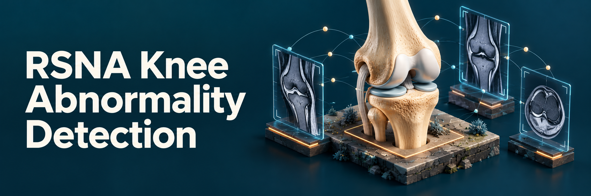

<p align="center">
  English | <a href="README.zh-CN.md">简体中文</a>
</p>
<p align="center">
  <a href="https://www.kaggle.com/competitions/rsna-knee-abnormality-detection">Contest Overview</a> | <a href="https://www.kaggle.com/competitions/rsna-knee-abnormality-detection/leaderboard">View Leaderboard</a> | <a href="https://www.kaggle.com/competitions/rsna-knee-abnormality-detection/writeups/21st-place-solo-gold-solution-llm-soft-labels">Solution Writeup</a>
</p>

A PyTorch framework for classifying **12 abnormalities from multi-series knee MRI**. It includes DICOM preprocessing, anatomical multiview rendering, grouped five-fold training, soft-label self-distillation, and the weights used in the **21st-place solo gold-medal solution** to [RSNA Knee Abnormality Detection](https://www.kaggle.com/competitions/rsna-knee-abnormality-detection).

The released ensemble scored **0.964 public / 0.955 private**. These are competition scores for the original submitted pipeline; the package provides its model weights and input recipe in a reusable implementation.

## Installation

Python 3.10+ and a CUDA-capable PyTorch installation are recommended. Install the PyTorch build appropriate for your GPU, then:

```bash
git clone https://github.com/zhuzhirui2005/RSNA-Knee-Abnormality-Detection.git
cd RSNA-Knee-Abnormality-Detection
pip install -e .
knee-mri download --output weights
```

The downloader checks SHA-256 hashes. Classification weights are hosted in [Releases](https://github.com/zhuzhirui2005/RSNA-Knee-Abnormality-Detection/releases); two auxiliary preprocessing checkpoints are retrieved from their original Kaggle datasets. The complete set is approximately 2.4 GB. See [Attribution and license](#attribution-and-license) for the different weight licenses.

## Run the pretrained ensemble

Use the competition's extracted directory layout:

```text
data/rsna/
├── test.csv
├── test_series.csv
└── test_series/
    └── <StudyInstanceUID>/
        └── <SeriesInstanceUID>/
            ├── 1.dcm
            └── ...
```

`test.csv` supplies `StudyInstanceUID`. `test_series.csv` supplies `StudyInstanceUID`, `SeriesInstanceUID`, `Anatomical_Plane`, `Fat_Suppression`, and `Fluid_Sensitive`. Use the original competition metadata, including its plane names (`Sagittal`, `Coronal`, `Axial`). **Reports and labels are not inference inputs.**

```bash
knee-mri predict \
  --data data/rsna --split test \
  --weights weights --device cuda:0 \
  --cache cache/test --output outputs/submission.csv
```

One GPU is sufficient: weights remain in host memory and classifiers move to the GPU one at a time. Studies are decoded and processed individually. `--chunk 32` reduces the number of windows encoded together on smaller GPUs (default: 64), without reducing coverage. A persistent cache avoids rebuilding DICOM views on subsequent runs; omit `--cache` to keep disk use bounded to the current study. Reserve additional disk space when retaining a large cohort's rendered views.

The output contains one row per study and these columns:

```text
StudyInstanceUID, ACL, MCL, Medial Meniscus, Lateral Meniscus,
Medial OA, Lateral OA, PF OA, Effusion, Synovitis, Baker's,
Contusion, Fracture
```

Probabilities are written to the requested CSV only after every requested branch has completed. An incomplete run does not publish a partial ensemble under the final output filename.

To run one branch, add `--branch llm`, `--branch distilled`, or `--branch public`.

## Models and ensemble

All three branches use **ConvNeXt-Small**, with three adjacent MRI slices as input channels. A class-specific spatial attention layer pools each window's feature map, and a second attention layer aggregates windows across the study. The two five-fold branches also include the upstream osteoarthritis extent head.

| Branch | Models | Training targets | Render / center crop | Ensemble weight |
|---|---:|---|---|---:|
| LLM-label continuation | 5 | LLM probabilities; two further low-learning-rate epochs after base training | 384 / 352 | 45% |
| Self-distilled student | 5 | 75% LLM probabilities + 25% corresponding-fold teacher probabilities; initialized from ImageNet | 384 / 352 | 45% |
| Public ConvNeXt-Small | 1 | Public checkpoint from [nartaa](https://www.kaggle.com/datasets/nartaa/rsna-knee-s6fall-weights) | 320 / 288 | 10% |

For each five-fold branch, **average logits first, then apply sigmoid**. The final output is a probability blend:

```python
p = 0.45 * sigmoid(mean(llm_fold_logits, axis=0)) \
  + 0.45 * sigmoid(mean(student_fold_logits, axis=0)) \
  + 0.10 * sigmoid(public_logits)
```

Each study is rendered as full-field views and anatomically positioned 100 mm local views. Windows contain three slices separated by approximately 3.5 mm; inference covers all centers selected by the physical stride. The 384-pixel branches use the image-based side correction. The public 320-pixel branch follows its original preprocessing without that correction. Both resolutions are generated from the native DICOM data, **not by resizing one branch's cache into the other**.

The release contains 11 classification checkpoints. A separate SKM-TEA VNet locates anatomical anchors, and a ResNet34 checks orientation; these are preprocessing models, not additional ensemble classifiers. Disabled report-state heads were removed from the exported five-fold weights.

## Prepare training data

Training uses the same directory layout with `train.csv`, `train_series.csv`, and `train_series/`. Render the multiview cache once:

```bash
knee-mri prepare --data data/rsna --split train \
  --weights weights --size 384 --device cuda:0 --cache cache/train384
```

Each study is saved as an independently readable NPZ. Horizontal uint8 differences and Zstandard compress the **rendered views losslessly**. DICOM-to-view resizing and intensity encoding are preprocessing operations; the cache is not a lossless replacement for the source DICOMs.

Provide a UTF-8 label CSV with this schema:

| Column | Meaning |
|---|---|
| `StudyInstanceUID` | Unique study identifier matching the image metadata |
| `group` | Patient/report grouping identifier |
| `fold` | Fixed integer fold assignment, normally 0–4 |
| The 12 target names above | Probabilities in [0, 1]; blank for unavailable targets |

All studies in a group must share a fold. Targets may be soft labels; missing targets are masked. Keep official gold and external validation studies outside the training table. [examples/labels.csv](examples/labels.csv) is a synthetic schema example, not training data.

The released five-fold branches were trained on 4,349 studies. Images, clinical reports, patient identifiers, original fold assignments, and annotation tables are not distributed here. To generate your own annotations, see the separate [RSNA Knee Reader](https://github.com/zhuzhirui2005/rsna-knee-reader) MCP server.

## Train and self-distill

### 1. Train base teachers

```bash
knee-mri train --config configs/train_llm.json \
  --labels data/labels.csv --cache cache/train384 \
  --fold 0 --device cuda:0 --output outputs/base/fold0
```

Repeat for folds 1–4, using a separate output directory and GPU for each concurrent job. Each model trains on the other four folds. The recipe uses an ImageNet-22K → ImageNet-1K ConvNeXt-Small initialization, at most 176 physical windows per training study, a shared random 352-pixel crop, soft BCE, AdamW, and gradient accumulation. The encoder/head learning rates are `1e-4`/`1e-3`.

Validation uses the original held-out probabilities, thresholded at `> 0.5` solely to compute per-target ROC AUC. `best.pt` tracks the highest observed macro AUC. Early stopping begins after eight epochs, with patience three and a `0.0005` improvement threshold; the maximum is 16 epochs. AUC against LLM targets measures agreement with weak labels, not independent clinical accuracy.

The original recipe initialized the classifier bias from training-fold report-consensus prevalence. Supply that table with `--bias-labels data/consensus.csv` to retain this choice; otherwise the supplied training-label prevalence is used.

### 2. Continue the LLM-label branch

```bash
knee-mri train --config configs/continue_llm.json \
  --labels data/labels.csv --cache cache/train384 \
  --fold 0 --initial outputs/base/fold0/best.pt \
  --output outputs/llm/fold0
```

This starts a new two-epoch stage at encoder/head learning rates `1e-5`/`1e-4`, with a fresh optimizer. Use **`last.pt`** for this branch, matching the released fixed two-epoch endpoint. It does not generate the distillation targets; those come from the base teachers.

### 3. Generate same-fold teacher targets

```bash
knee-mri teacher --labels data/labels.csv --fold 0 \
  --checkpoint outputs/base/fold0/best.pt --cache cache/train384 \
  --output outputs/teacher/fold0.csv
```

Teacher 0 predicts only the training partition for student 0. Both exclude fold 0. These teacher targets are in-sample within the training partition; they are **not OOF targets**. Validation labels remain unchanged.

### 4. Train the self-distilled student from ImageNet

```bash
knee-mri train --config configs/train_llm.json \
  --labels data/labels.csv --cache cache/train384 \
  --fold 0 --teacher outputs/teacher/fold0.csv --teacher-weight 0.25 \
  --output outputs/student/fold0
```

Omitting `--initial` initializes the student from ImageNet, independently of the teacher's MRI weights. Repeat the continuation, teacher prediction, and student training stages for all five folds. Use `best.pt` for each student's inference weights.

Export selected checkpoints to use them with the same ensemble loader (repeat for all folds):

```bash
knee-mri export --checkpoint outputs/llm/fold0/last.pt --output weights/llm_fold0.pt
knee-mri export --checkpoint outputs/student/fold0/best.pt --output weights/distilled_fold0.pt
```

### Resume and evaluate

```bash
# Resume with the same arguments and configuration.
knee-mri train --config configs/train_llm.json \
  --labels data/labels.csv --cache cache/train384 \
  --fold 0 --output outputs/base/fold0 --resume

knee-mri evaluate --labels data/labels.csv \
  --predictions outputs/base/fold0/best_validation.csv
```

`resume.pt` stores the latest completed epoch, optimizer, scheduler, and random states. `best_validation.csv` and `history.json` contain per-fold predictions and per-target metrics. The framework provides the training recipe; reproducing the released weights from scratch also requires the original annotation snapshot and split, which are not included.

## Repository layout

```text
knee_mri/
  model.py               ConvNeXt and study-level attention
  preprocessing/         DICOM orientation, anatomy anchors and multiview rendering
  data.py, sampling.py    Compressed cache and physical window selection
  training.py             Grouped training and soft-target distillation
  inference.py            Complete-study inference and fixed ensemble
  resources/weights.json  Download locations, hashes and licenses
configs/                  Base training and continuation recipes
examples/                 Synthetic input schema
```

## Attribution and license

The model architecture and anatomical preprocessing derive from [Heliosli's public RSNA solution](https://www.kaggle.com/code/heliosli/0-957-latest-dataset-score-in-one-click), also distributed in [nartaa's package](https://www.kaggle.com/datasets/nartaa/rsna-knee-s6fall-weights). Adapted source files identify their origin. VNet transitions are adapted from MONAI 0.6 (Copyright 2020–2021 MONAI Consortium, Apache-2.0). ConvNeXt and ImageNet initialization use [timm](https://github.com/huggingface/pytorch-image-models).

Framework code and the ten newly released classification checkpoints are [Apache-2.0](LICENSE). The public checkpoint, `public_convnext_small.pt`, is nartaa's unmodified `E_prior_s42_fall.pt`, licensed under [CC BY-NC 4.0](https://creativecommons.org/licenses/by-nc/4.0/), with attribution to nartaa and Heliosli. Its noncommercial restriction still applies.

The [SKM-TEA](https://github.com/StanfordMIMI/skm-tea) anatomy checkpoint ([source](https://www.kaggle.com/datasets/heliosli/rsna-orthofoundation-fold0-epoch7-20261004)) and [Heliosli's orientation checkpoint](https://www.kaggle.com/datasets/heliosli/rsna-knee-compact-v1) are downloaded from their original datasets and retain their upstream terms. File sources and hashes are listed in [weights.json](knee_mri/resources/weights.json).

This repository is a research and competition implementation, not a clinically validated diagnostic system.
